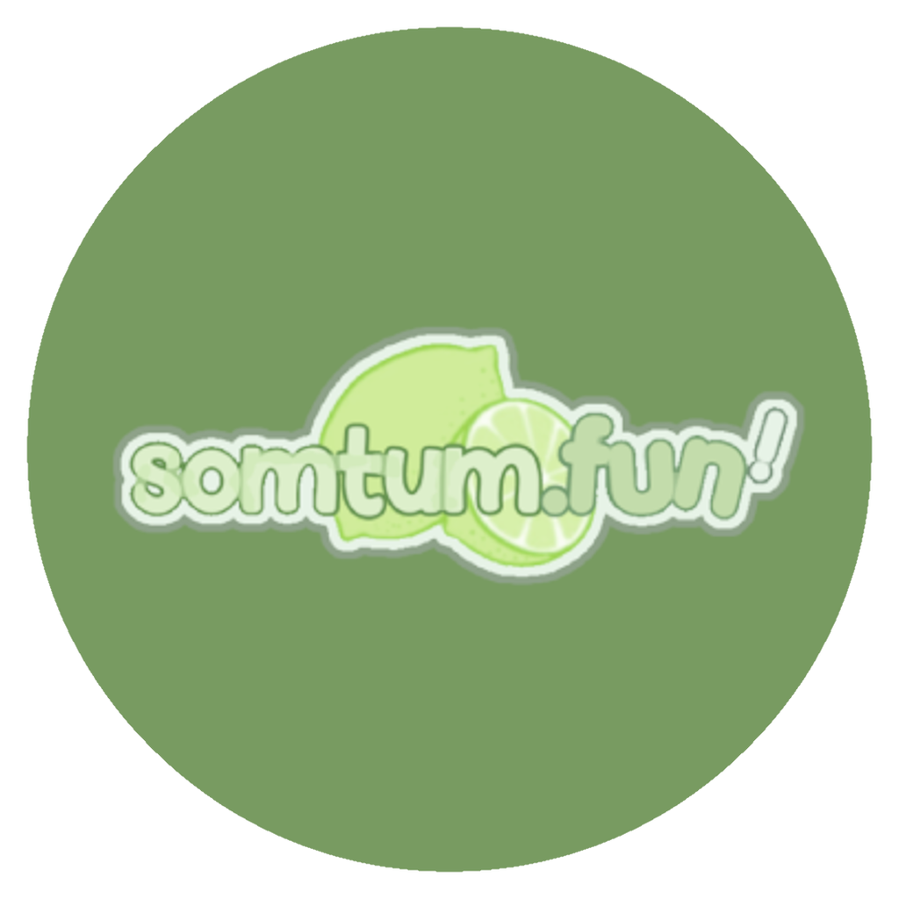

<p align="center">
  
</p>

# TumThai

The client for the **somtum.fun** private server: a fork of [osu!](https://github.com/ppy/osu) (*lazer*), built and tuned for playing on somtum.fun.

> TumThai is a fan-made, unofficial client. It is not affiliated with, endorsed by or connected to ppy Pty Ltd or the osu! team. osu! is a trademark of ppy Pty Ltd.

> 🚧 **Work in progress.** Expect bugs, breaking changes, and features that are still being built. Please report issues and don't rely on it being stable yet.

It's the osu! game you know, set up for somtum.fun:

- **Connects to somtum.fun out of the box**: no setup needed to start playing.
- **Relax / Autopilot (RX/AP)**: RX/AP leaderboards on song select, RX/AP profiles and rankings, and RX/AP score submission.
- **Configurable server & avatar host**: advanced users can point the client at another compatible private server from in-game settings, no rebuild required.

---

## ⚠️ Important: please read before using

### Support osu! first

TumThai is a **community fork** that builds on the work of [ppy](https://github.com/ppy) and the osu! team. **Please support official osu! first:**

- Play and support the official game at **[osu.ppy.sh](https://osu.ppy.sh)**.
- Consider buying [osu!supporter](https://osu.ppy.sh/home/support) to back the people who make all of this possible.
- This fork would not exist without the original osu! project. All credit for the game itself goes to ppy and the osu! contributors.

### 🚫 Never connect this client to official osu!

> **Do NOT use this client to connect to `osu.ppy.sh` or `dev.ppy.sh`.**

TumThai is a **third-party client** meant **only** for private servers. Connecting it to the official osu! servers (`osu.ppy.sh` / `dev.ppy.sh`) is against the [osu! rules](https://osu.ppy.sh/wiki/en/Rules) and **will get your official account restricted or banned.**

Use it **only** with private servers you are allowed to play on. You are responsible for how you use it.

---

## Running

Download TumThai from **[dl.blueskychan.dev/lazer](https://dl.blueskychan.dev/lazer/)**:

- **Windows installer** (`TumThai-<version>-win-Setup.exe`): installs TumThai, adds it to the Start menu and keeps it up to date.
- **Windows portable** (`TumThai-<version>-win-Portable.zip`): unzip anywhere and run `tumthai.exe`. Nothing is installed.
- **Linux AppImage** (`TumThai-<version>-x86_64.AppImage`): make it executable and run it:

```shell
chmod +x TumThai-*-x86_64.AppImage
./TumThai-*-x86_64.AppImage
```

### Choosing a server

By default the client connects to **somtum.fun**, no configuration needed. To play on a different compatible private server, open **Settings → Online → Connection** and set:

- **Custom server URL**: the host of the private server (e.g. `osu.example.com`). Leave empty to use somtum.fun. A restart is required.
- **Custom avatar URL**: the host serving user avatars (avatars are looked up as `https://{host}/{userId}`). Leave empty to use the default.

---

## Building from source

### Prerequisites

- A desktop platform with the [.NET 10.0 SDK](https://dotnet.microsoft.com/download) installed.

An IDE with C# support is recommended: [JetBrains Rider](https://www.jetbrains.com/rider/), [Visual Studio](https://visualstudio.microsoft.com/vs/), or [Visual Studio Code](https://code.visualstudio.com/) with the C# Dev Kit.

### Get the source

```shell
git clone https://github.com/somtum-fun/TumThai
cd TumThai
```

### Run

```shell
dotnet run --project osu.Desktop
```

For performance testing or producing a build, add `-c Release`. If a build fails, try `dotnet restore` first. When loading in an IDE, prefer the `osu.Desktop.slnf` solution filter.

### Building a Linux AppImage

```shell
./build-osu-appimage.sh -o dist
```

This publishes a self-contained build (the .NET runtime is bundled) and packages it with [`appimagetool`](https://github.com/AppImage/appimagetool).

### Logo and icons

TumThai's logo is `assets/tumthai/logo.png`. After changing it, run `python3 assets/tumthai/make-textures.py` (needs Pillow): it remakes the in-game logo textures (`osu.Game/Resources/Textures`, which take the place of ppy's), `assets/lazer.png` and `osu.Desktop/lazer.ico`.

---

## Contributing

Issues and pull requests are welcome. For game-engine or gameplay changes that aren't specific to this fork, please consider contributing them upstream to [ppy/osu](https://github.com/ppy/osu) so the whole community benefits.

## Licence

This fork, like upstream osu!, is licensed under the [MIT licence](https://opensource.org/licenses/MIT). See [the licence file](LICENCE) for details. [tl;dr](https://tldrlegal.com/license/mit-license): do what you want, as long as you include the original copyright and licence notice.

This **does not** cover the "osu!" or "ppy" branding (software, resources, advertising, or promotion), which is protected by trademark law. ppy's game resources are covered by a separate licence: see [ppy/osu-resources](https://github.com/ppy/osu-resources). The TumThai logo and icons belong to somtum.fun.

## Credits

- [osu!](https://github.com/ppy/osu) by [ppy](https://github.com/ppy) and contributors: the game this is built on. ❤️
- [torii-osu](https://github.com/ShikkesoraSIM/torii-osu) (the Torii client): reference for the Relax / Autopilot private-server integration.
- [g0v0-server](https://github.com/GooGuTeam/g0v0-server): reference for lazer private-server support.
